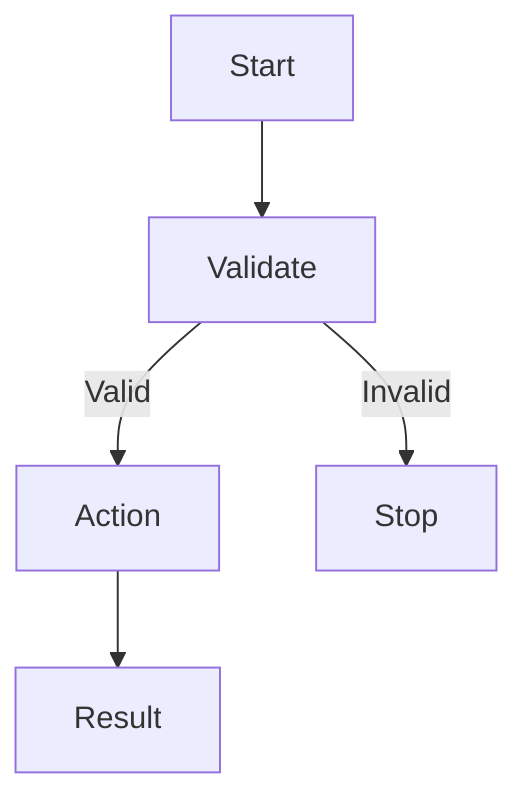

# [Workflow name]

> Purpose: [One sentence describing the problem solved.]

## Overview

[What it does, what it intentionally does not do, and its place in delivery or operations.]

| Attribute | Details |
| --- | --- |
| Trigger | [push / pull_request / schedule / manual / other] |
| Branches or paths | [Scope] |
| Runner | [Label or environment] |
| Timeout | [Configured value] |
| Permissions | [Minimum token permissions] |

## Inputs, secrets, and variables

| Name | Required | Type | Owner | Purpose |
| --- | --- | --- | --- | --- |
| [NAME] | [Yes/No] | [Type] | [Owner] | [Purpose] |

Never document secret values. Explain location, rotation, and least privilege.

## Flow and side effects

## Security and reliability

- [ ] Least-privilege permissions
- [ ] Untrusted input validation
- [ ] Secret-safe logs and artifacts
- [ ] Pinning or dependency control
- [ ] Timeout, concurrency, cancellation, and rollback

## Verification and troubleshooting

[Static checks, dry run, runtime evidence, skipped checks, and safe next steps.]

## Rollback and recovery

[How to stop, revert, disable, or recover.]
