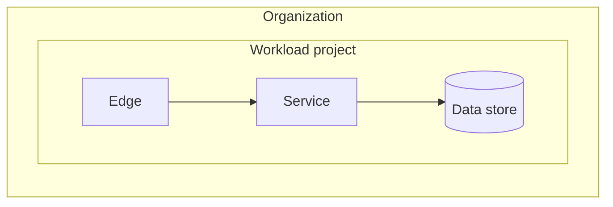

# Solution guide: workload name

Status: Draft for review. Decision records in this guide are Proposed until the named decision owner accepts them.

## 1. Summary

Two or three sentences: the business outcome, the chosen archetype and the main products.

## 2. Requirements

| ID | Requirement | Source | Priority |
|---|---|---|---|
| FR-1 | | | |
| NFR-SEC-1 | | | |
| NFR-REL-1 | Availability target, RTO, RPO | | |
| NFR-COST-1 | | | |
| NFR-OPS-1 | | | |
| NFR-PERF-1 | | | |
| NFR-SUS-1 | | | |

Resolved contradictions and the choice the user made:

## 3. Current state and dependencies

Where the workload runs today, its pain points, and every upstream, downstream, identity and network dependency.

## 4. Decomposition and deployment archetype

Components, whether each is stateful, data classification per store, and the archetype with the reason it meets NFR-REL and residency requirements.

## 5. Product mapping

| Component | Recommended product or feature | Why, with citation | Alternatives | Trade-offs | Release status checked |
|---|---|---|---|---|---|

## 6. Architecture diagram

## 7. Architecture description

Purpose of each component, the identity each one uses to call the next, the data flow and the control flow.

## 8. Recommendations by pillar

### Security, privacy and compliance
### Reliability
### Operational excellence
### Cost optimization
### Performance optimization
### Sustainability

Tie each recommendation to a requirement ID.

## 9. Decision records

List each decision record with its ID, title, status and owner.

## 10. Deployment guidance

Prerequisites (projects, APIs, roles, quotas), the IaC layout, the deployment order, and the steps the user runs.

## 11. Validation plan and traceability

| Requirement | Design element | Check | Who runs it | Status |
|---|---|---|---|---|

## 12. Assumptions and open questions

## 13. References

Official documentation pages cited above.
