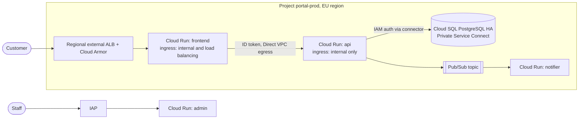

# Worked example: private three-tier web application on Cloud Run

Synthetic scenario for the `design-solution.prompt.md` workflow. Names, figures and the organization are invented.

## Phase 1: discovery

The user asks for "a secure customer portal on Google Cloud". The agent applies gcp-solution-architecture and asks only for what is missing, explaining why each item matters:

- Availability target and RTO/RPO (drives region count and database configuration). Answer: 99.9% monthly, RTO 4 hours, RPO 15 minutes.
- Residency (drives load balancer type and CDN). Answer: personal data must stay in the EU.
- Peak load and latency (drives concurrency and caching). Answer: 300 requests per second at peak, p95 under 400 ms.
- Budget and operations model. Answer: small team, no Kubernetes experience, prefers managed services.

Contradiction found and resolved: the user also wanted "a global CDN for speed". Global TLS termination and edge caching can process requests outside the EU, which conflicts with the residency requirement. The agent explained both sides and the user chose a regional external Application Load Balancer without CDN for personal-data paths. No product was named until this was settled.

Requirements were numbered FR-1 to FR-4 and NFR-SEC-1, NFR-RES-1, NFR-REL-1, NFR-PERF-1, NFR-COST-1, NFR-OPS-1.

## Decomposition and archetype (confirmed by the user)

Edge (public HTTPS entry with WAF), presentation tier (stateless), application tier (stateless, private), relational data store (personal data, stateful), cache (non-authoritative), asynchronous notifications, identity for staff tools, operations. Archetype: regional in one EU region, because the 99.9% target is met by zone redundancy and region loss is covered by backups within the RTO.

## Phase 2: product mapping (excerpt, approved before drawing)

| Component | Recommendation | Why | Runner-up and trade-off |
|---|---|---|---|
| Edge | Regional external Application Load Balancer with Cloud Armor | TLS terminates in-region (NFR-RES-1); WAF and rate limiting (NFR-SEC-1) | Global external Application Load Balancer with Cloud CDN: faster for global users, but terminates TLS at the edge outside the EU |
| Presentation and application tiers | Cloud Run services | Team has no Kubernetes skills (NFR-OPS-1); scales to zero off-peak (NFR-COST-1) | GKE Autopilot: more control, more operations |
| Data | Cloud SQL for PostgreSQL, Enterprise Plus edition, HA, Private Service Connect | Relational model, in-region HA, IAM database authentication | AlloyDB: higher performance than needed at this scale |
| Notifications | Pub/Sub push to a Cloud Run service | Decouples email sending from requests | Cloud Tasks: better if per-call rate control is needed |

Release status and EU-region availability were checked in documentation for each product; one feature found only in Preview was replaced by a GA alternative.

## Diagram

## Decisions recorded (status Proposed, owner: the portal's lead architect)

ADR-001 region; ADR-002 regional load balancer without CDN; ADR-003 Cloud Run over GKE Autopilot; ADR-004 Cloud SQL edition and HA.

## Phase 3: validation plan

Static checks the agent ran with Level 1 authority: `terraform fmt -check`, `terraform validate` on the skeleton, and a review of every ingress setting and IAM binding against the design. Runtime checks written for the user to run after their deployment: direct requests to each `run.app` URL are refused; the custom domain answers through the load balancer; a test injection request returns 403 from Cloud Armor; the managed certificate is active; logs show api-to-database calls over the private endpoint.

## Result

Status DESIGN_READY_FOR_REVIEW: every requirement is traced, static checks passed, runtime checks are unverified because nothing is deployed, and four decisions await the owner. Deploying is a Level 2 step the user takes.
